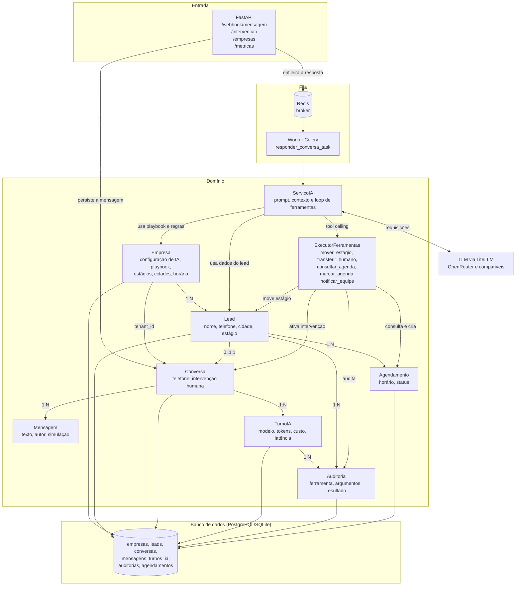

# Motor de IA para leads

API e worker de atendimento automatizado para leads. O sistema recebe mensagens
por webhook, mantém o histórico da conversa, conduz a qualificação do lead com
um LLM e executa ferramentas de negócio, como mover o lead de estágio,
transferir o atendimento para um humano e consultar ou marcar horários na
agenda.

## Stack

- Python 3.13
- FastAPI para a API HTTP
- SQLAlchemy assíncrono e Alembic para persistência
- PostgreSQL em produção, SQLite para desenvolvimento e testes
- Celery com Redis para processar respostas da IA em segundo plano
- LiteLLM para acesso ao provedor de LLM

## Arquitetura

O projeto segue uma arquitetura em camadas, com domínio rico e inversão de
dependências na infraestrutura:

| Camada | Diretório | Responsabilidade |
| --- | --- | --- |
| API | `app/src/api` | Rotas HTTP e validação de entrada |
| Aplicação | `app/src/servicos` | Casos de uso, executores e serializadores |
| Domínio | `app/src/dominio` | Agregados, objetos de valor, regras e serviço de IA |
| Repositórios | `app/src/repositorio` | Contratos de leitura e persistência |
| Infraestrutura | `app/src/infraestrutura` | ORM, sessão, unidade de trabalho, Celery e Alembic |

## Diagrama de relacionamentos



## Modelo de dados

- `Empresa` é a raiz do tenant. Guarda as configurações de IA, o playbook e os
  estágios permitidos no banco, na coluna JSON `configuracoes`.
- `Lead` pertence a uma empresa (`empresa_id`) e é identificado por telefone
  dentro dela. O estágio do lead é atualizado pelas ferramentas da IA.
- `Conversa` é ligada à empresa por `tenant_id` e pode apontar para um lead
  (`lead_id`). A coluna `lead_id` é única, então cada lead tem no máximo uma
  conversa.
- `Mensagem` pertence a uma conversa e registra autor, se foi gerada pela IA,
  se foi uma intervenção humana e se é uma simulação.
- `Agendamento` pertence a uma empresa e a um lead, guarda o horário e o status
  confirmado ou cancelado.
- `TurnoIA` registra cada tentativa de resposta da IA para uma mensagem, com
  modelo, tokens, custo estimado, latência e erro.
- `Auditoria` audita cada chamada de ferramenta, incluindo argumentos,
  resultado, sucesso e um hash para evitar duplicidade no mesmo turno.

## Fluxo de atendimento

1. O webhook `POST /webhook/mensagem` recebe a mensagem e ignora duplicatas pelo
   identificador externo.
2. A mensagem é persistida na conversa. Se o autor for humano, a intervenção
   humana é ativada e a IA deixa de responder.
3. A resposta da IA é enfileirada no Celery com `countdown` igual à
   `janela_de_resposta` da empresa.
4. O worker carrega a empresa, verifica se ela está ativa e dentro do horário de
   atendimento, monta o contexto com o histórico e o playbook e chama o LLM.
5. O `ServicoIA` executa o loop de tool calling. As ferramentas validam os
   argumentos, alteram o estado no banco e são auditadas em `auditorias`.
6. A resposta final precisa ser texto natural e é salva como mensagem da IA.
   O `TurnoIA` é concluído com modelo, tokens, custo e latência.
7. Em caso de falha do LLM, a tarefa usa backoff exponencial de 15s, 30s e 60s.

## Executando

```bash
make setup          # instala dependências com Poetry
make migrate        # aplica as migrações
make dev            # sobe a API na porta padrão do Uvicorn
make redis          # sobe um Redis local via Docker
make celery         # inicia o worker Celery
```

Variáveis principais: `DATABASE_URL`, `CELERY_BROKER_URL`, `LLM_MODEL`,
`LLM_API_KEY` ou `OPEN_ROUTER_KEY`, além dos preços por milhão de tokens usados
no cálculo de custo.

## Qualidade

```bash
make test
make ruff
make format-check
make migration-check
```
